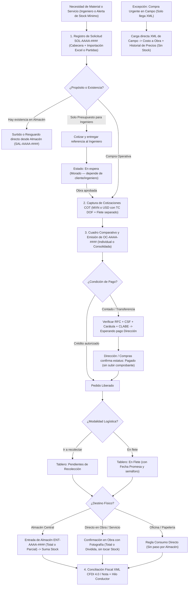
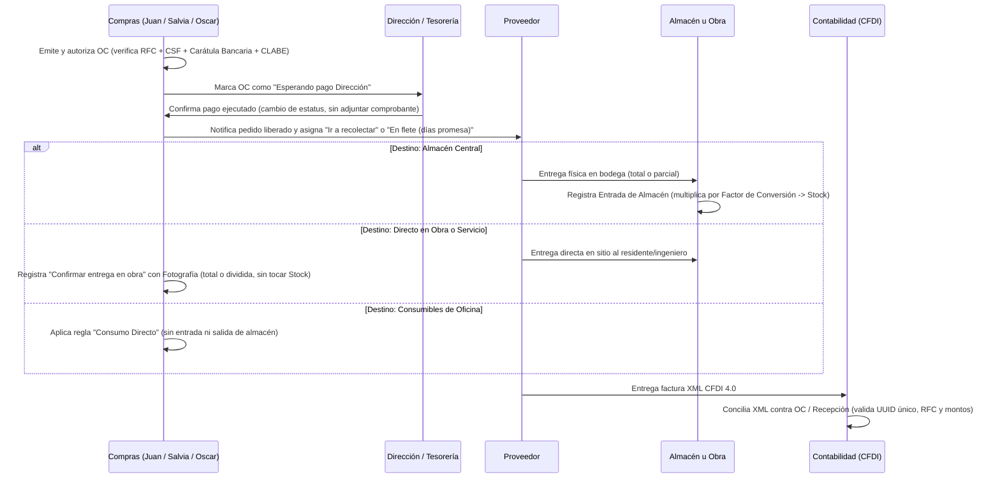

# Especificación Funcional, Procesos, Reglas de Negocio y Nomenclaturas de Compras y Almacén — Plataforma Interna LEBAREF

**Documento de alineación entre Departamento de Compras y Departamento de TI**  
**Área usuaria / propietaria funcional:** Departamento de Compras y Almacén (Lebaref)  
**Destino tecnológico:** Plataforma interna propia desarrollada por el Departamento de TI  
**Referencia viva:** Sistema interno actual de Compras y Almacén (operando al 100% mientras se desarrolla la plataforma corporativa)

> [!IMPORTANT]
> **Propósito de este documento:** Entregar al Departamento de TI la radiografía exacta de **qué hace, cómo opera y qué reglas de negocio requiere** el Departamento de Compras y Almacén para que se construyan dentro de la **plataforma interna general de la empresa**, junto con todas las nomenclaturas actuales para evaluación de TI y las bases de datos limpias listas para migrar al momento de salir a producción.

---

## 1. Contexto Operativo y Estrategia de Transición

El flujo actual de Compras y Almacén fue diseñado a la medida de la operación real de **Lebaref** (*HVAC, Electricidad, Obra Civil, Mantenimiento Industrial, Comercializadora y Corporativo*), eliminando cuellos de botella burocráticos que frenan las compras urgentes de obra, pero asegurando control fiscal (`CFDI 4.0`), trazabilidad documental y control físico de inventario.

### Acuerdos base ya definidos para el proyecto con TI
1. **Desarrollo en Plataforma Interna (sin ERPNext):** TI construirá los módulos dentro de la plataforma interna de la empresa. Nuestro sistema actual funciona como **prototipo vivo de referencia** (cualquier pantalla, cálculo o formato se puede consultar en vivo) y como fuente de datos depurados (`CSV` / `JSON` / `SQL`) para la migración inicial.
2. **Continuidad operativa durante el desarrollo:** Mientras TI desarrolla la plataforma interna, **Compras, Almacén y los Ingenieros seguirán operando sin cambios en el esquema actual** (sistema actual de Compras + plantilla Excel de solicitud + espejo de seguimiento en Google Sheets). Una vez concluido el desarrollo de la plataforma interna se ejecutará la transición e incorporación formal.
3. **Convivencia futura con Ingenieros:** Aún está por definirse cómo interactuarán los ingenieros directamente dentro de la plataforma interna una vez terminada; sin embargo, se recomienda **conservar siempre la opción de importar solicitudes por Excel** además de la captura en pantalla, ya que en arranques de obra de 50 a 150 partidas el Excel evita horas de captura manual.
4. **Confirmación simple de pagos (sin carga de comprobantes):** Para liberar compras de contado/transferencia **no es necesario** que Dirección o Tesorería suban comprobantes bancarios al sistema; basta con la confirmación del cambio de estatus de pago para destrabar la recolección o el flete.

---

## 2. Roles, Perfiles y Segregación de Funciones (`RBAC`)

La plataforma interna debe separar claramente **quién captura y da seguimiento** de **quién autoriza** compromisos financieros o consulta analítica confidencial:

| Perfil / Actor | Usuarios Actuales | Responsabilidades y Permisos Requeridos | Restricciones Obligatorias |
| :--- | :--- | :--- | :--- |
| **Gerencia de Compras** | Oscar Gómez | Control total del módulo: autorización de Órdenes de Compra (`OC`), autorización de sustituciones, depuración/fusión de proveedores, administración de catálogo/equivalencias y **acceso exclusivo al Motor de Precio Estimado y Confianza**. | Único perfil con permiso en servidor y pantalla para ver precios estimados, `%` de confianza, modo sombra y calibración de umbrales. |
| **Coordinación de Almacén** | Airan Echeverría | Recepciones en bodega (con o sin `OC`), entregas/resguardos a obra, consumos reales, devoluciones, actas de sobrante, conteos físicos/mermas, custodia de herramientas (`HER`), kits (`KIT`), flotilla (`VEH`), apoyo en catálogo y alta/edición de proveedores. | Sin acceso al motor predictivo de precios ni autorización de `OC`. |
| **Auxiliares de Compras** | Juan Cetina, Salvia Sosa | Registro de solicitudes e importación de Excel, alta y modificación de proveedores (incluyendo `RFC`, `CSF`, `Carátula Bancaria` y `CLABE`), captura de cotizaciones (`MXN`/`USD + TC DOF`), seguimiento de pagos con Dirección, logística (*ir a recolectar* vs. *en flete*), confirmación en obra con foto, carga de XML e importación histórica. | **No autorizan `OC` definitivas**, no eliminan proveedores con historial y **tienen bloqueado a nivel API/BD** cualquier monto estimado o `%` de confianza. |
| **Dirección / Tesorería** | Dirección | Visualiza solicitudes de pago listas (con proveedor fiscalmente validado) y **confirma estatus de pago realizado** (sin necesidad de adjuntar comprobante). | — |
| **Contabilidad / Finanzas** | Área Contable | Consulta recepciones confirmadas, `OC` conciliadas y paquete `XML CFDI 4.0` pre-validado (`UUID` único, impuestos separados y `TC DOF`), gestionando cuentas por pagar y pólizas. | — |
| **Ingenieros / Solicitantes** | Gerencias y Residentes | *Durante el desarrollo:* envían plantilla Excel y consultan espejo en vivo. *Al implementar la plataforma interna:* esquema de captura directa por definir junto con TI. | No deben ser frenados por campos técnicos obligatorios que desconozcan al momento de pedir material. |

---

## 3. Mapa General del Proceso End-to-End de Compras y Almacén

---

### 3.1 Módulo 1: Solicitudes de Material (`SOL`) sin Fricción Operativa

1. **Creación limpia en dos pasos (Cabecera $\rightarrow$ Detalle):**
   * Un único botón **`Nueva solicitud`** captura exclusivamente la cabecera (*Nombre descriptivo de referencia, Solicitante, Departamento/Área, Proyecto/Obra destino, Fecha requerida, Notas y Propósito: Compra operativa vs. Solo presupuesto*), creando el folio en `Borrador`.
   * Ya dentro del detalle de la solicitud se cargan los artículos mediante **`Importar Excel`** o captura manual de renglones.
2. **Convivencia de Artículos de Catálogo (`SKU`) y Conceptos Libres:**
   * Al solicitar **no se obliga** a llenar marca, modelo ni especificaciones técnicas estructuradas.
   * Una misma solicitud puede combinar SKUs del catálogo (`PRD-####`) y **Conceptos Libres** (texto abierto cuando es un material nuevo, fabricación especial o servicio). Posteriormente, Compras puede vincular ese concepto libre a un SKU existente o enviarlo a la Bandeja de Equivalencias sin perder el texto original del ingeniero.
3. **Presentación por Bloques de Partida (sin columna repetitiva):**
   * En pantalla y en todos los PDFs tamaño Carta, los renglones se agrupan bajo **barras separadoras de ancho completo por Partida de obra** (ej. *PARTIDA 01: EQUIPOS HVAC*, *PARTIDA 02: TUBERÍA Y CONEXIONES*), eliminando la columna repetitiva `Partida` en cada fila.
4. **Anexos vinculados (`-A1`, `-A2`) y salida a WhatsApp:**
   * Si una solicitud ya está en compra y la obra pide material adicional, se genera un **Anexo hijo** ligado al folio padre (`SOL-2026-0036-A1`) para no alterar cotizaciones cerradas.
   * Botón **`Copiar para WhatsApp`** que genera texto limpio con partidas, descripciones, cantidades y unidades (sin precios internos) listo para pegar a proveedores.
5. **Catálogo de Estados de Solicitud (con diferenciación visual obligatoria):**
   * La plataforma debe almacenar y filtrar de forma independiente:
     * `Borrador` (gris) — en armado de partidas.
     * `Pendiente` (naranja) — pendiente activo que depende de Compras.
     * `En espera` (morado — **color distinto obligatorio respecto a Pendiente**) — pausada porque depende de respuesta externa (aprobación de cliente, definición técnica de ingeniero, etc.).
     * `Parcialmente pedida` / `Pedida` (azul) — ya cuenta con `OC`.
     * `Parcialmente recibida` / `Recibida` — entregada en almacén u obra.
     * `Concluida` (verde) — cerrada operativamente.
     * `Cancelada` (rojo).

---

### 3.2 Módulo 2: Directorio de Proveedores, Cotizaciones (`MXN`/`USD`) y Comparativa

1. **Proveedores editables por todo el equipo de Compras y Almacén:**
   * Cualquier usuario de Compras o Almacén puede **crear y modificar proveedores** (incluso desde un modal rápido a mitad de una cotización sin perder su captura). Solo Gerencia puede eliminar o fusionar proveedores duplicados (bloqueando bajas si tienen historial).
   * En la **primera vista / ficha principal** del proveedor deben estar disponibles y editables: *Nombre comercial / Razón social, Especialidad (¿Qué cotiza? — para el buscador "¿A quién cotizar?"), `RFC`, Contacto, Teléfono/WhatsApp, Correo, Condición de pago habitual, `CLABE`, archivo de Constancia de Situación Fiscal (`CSF` + fecha) y archivo de `Carátula Bancaria`*.
2. **Reglas reales de Cotización:**
   * **Sin mínimo ni máximo obligatorio de cotizaciones** y sin bloqueos de justificación forzosa al adjudicar (por compras de urgencia, refacciones de marca única o precios ya convenidos).
   * Permite adjuntar el soporte original del proveedor (`PDF`, imagen o `Excel`) e importar precios por plantilla.
3. **Multimoneda estricta (`MXN` y `USD` con `TC DOF`):**
   * Si la cotización viene en **`USD`**, el sistema **exige capturar manualmente el Tipo de Cambio oficial del DOF publicado ese día**, congelando tres datos auditables: precio en `USD`, `TC DOF` aplicado (4 decimales) y su equivalente en `MXN`.
4. **Separación entre Precio Limpio y Flete:**
   * El flete se registra en un campo separado (`flete_sin_iva`). Cada partida conserva su **precio unitario limpio sin flete** (para no distorsionar la historia estadística del producto) y calcula por separado el **costo puesto en sitio** prorrateado.
5. **Cuadro Comparativo limpio y Consolidación de `OC`:**
   * En cada celda proveedor–artículo del Cuadro Comparativo se muestra únicamente: **Monto Unitario**, **Subtotal de esa partida** y **Total con IVA de esa partida** (nunca mezclar el impuesto global de toda la cotización dentro de la celda individual).
   * Soporta **adjudicación dividida** (distintos renglones a distintos proveedores en 1 clic) y **consolidación de varias solicitudes/cotizaciones de un mismo proveedor en una sola `OC`**.

---

### 3.3 Módulo 3: Liberación de Pago, Logística Diaria y Recepción Multidestino

**Cinco casos operativos reales (excepciones) que la plataforma interna debe contemplar desde diseño:**
1. **Compra Directa en Campo (solo llega `XML`):** Cuando un ingeniero paga una urgencia en sitio y días después solo entrega la factura, Compras sube el **`XML` directo de campo** indicando Proyecto/Obra, Departamento y Comprador. Se imputa el costo a la obra y se guarda el precio unitario en el historial, **sin obligar a inventar una Solicitud ni `OC` previa y sin sumar stock falso al almacén**.
2. **Entrada Anticipada a Almacén sin `OC`:** Cuando el proveedor deja material urgente en bodega antes de cerrar la orden, Almacén registra una *Entrada pendiente de regularizar* y días después la enlaza a la `OC` definitiva **sin duplicar existencias**.
3. **Conversión de Unidad Compra $\leftrightarrow$ Inventario:** Ejemplo real: se compra `1 Caja` o `1 Rollo`, pero Almacén controla y entrega por `Pieza` o `Metro` multiplicando automáticamente por el `FactorConversion` configurado en el artículo.
4. **Sustitución Autorizada de Marca/Medida:** Si el proveedor surte un equivalente distinto al pedido en la `OC`, Gerencia autoriza el sustituto para que Almacén reciba el artículo físico real descontando el saldo pendiente del renglón original.
5. **Ciclo completo de Obra en Almacén:** Diferenciar entre **Resguardo/Transferencia a obra** (aún no consumido), **Consumo definitivo imputado a obra**, **Devolución de material a bodega**, **Reingreso de sobrantes con acta foliada** y **Ajustes por conteo físico o merma** (captura por almacén, autorización por responsable) + **Carta Responsiva imprimible** cuando se entrega Equipo de Protección Personal (`EPP`).

---

### 3.4 Módulo 4: Archivo y Conciliación `CFDI 4.0` + Hilo Conductor de 360°

1. **Lector automático de `XML CFDI 4.0`:**
   * Extrae `UUID` (bloqueando duplicados en toda la empresa), `RFC Emisor`, `RFC Receptor`, `Serie/Folio`, `Moneda`, `TipoCambio`, `Subtotal`, descuentos, impuestos trasladados/retenidos y cada concepto (`ClaveProdServ`, `NoIdentificacion`, `Cantidad`, `ClaveUnidad`, `ValorUnitario`, `Importe`).
   * **Mapa inteligente `RFC + ClaveProveedor -> SKU interno`:** una vez que un concepto XML de cierto proveedor se vincula a un artículo `PRD-####`, el sistema aprende esa relación para pre-mapear sus futuras facturas automáticamente (ya contamos con **558 mapeos reales** listos para migrar).
   * Permite liquidar compras menores con **Nota / Ticket sin CFDI** (`NOTA-OC-...`) dejando motivo auditable.
2. **Hilo Conductor Único Conciliado:**
   * Vista integrada en una sola pantalla que conecta de punta a punta:
     `Solicitud (SOL) ↔ Cotización (COT) ↔ Orden de Compra (OC) y Estado de Pago ↔ Logística / Foto en Obra ↔ Entrada/Salida Almacén ↔ Factura XML CFDI`
   * Incluye una **Bitácora de Conciliación** para anotar cambios acordados entre etapas (ajustes de cantidad, entregas parciales o acuerdos comerciales).

---

## 4. Gobierno de Catálogo Maestro, Equivalencias e Historial

1. **Catálogo Multigerencia y Ficha Técnica Gradual (`665+` artículos activos):**
   * Más de la mitad de los artículos son compartidos entre distintas ingenierías, por lo que cada SKU admite **múltiples etiquetas de gerencia usuaria** simultáneamente (`HVAC`, `Eléctrico`, `Obra Civil`, `Mantenimiento Industrial`, `Oficina`).
   * Agrupación por **Categoría** y **Familia técnica normalizada** (evitando duplicados por mayúsculas o acentos), con sugerencias de atributos técnicos según categoría, carga rápida de foto (`Ctrl+V`) e impresión de códigos de barras **`Code 128`** compatibles con lector láser/inalámbrico.
2. **Dos banderas por artículo indispensables:**
   * **`Exige recotizar siempre`:** para tableros especiales, fabricaciones a medida o insumos muy volátiles.
   * **`Consumo directo (Oficina)`:** conserva código `PRD-####` para estadísticas de gasto e historial de precios, pero no genera inventario en almacén.
3. **Bandeja de Alias y Equivalencias con Gerencias:**
   * Nunca se borra ni sobrescribe el texto original escrito por el ingeniero o el proveedor.
   * Cualquier integrante del equipo envía candidatos a revisión para dictaminar junto con las gerencias: *Exacto (Alias directo)*, *Equivalente aprobado*, *Sustituto puntual* o *Distinto (No agrupar)*, definiendo además su **Alcance**: **`Toda la empresa`** vs. **`Solo Cliente / Proyecto específico`**.
4. **Repositorio separado de Cotizaciones Históricas:**
   * Tabla independiente para importar masivamente por Excel cotizaciones pasadas (`MXN`/`USD` + `TC DOF`), con huella antiduplicados (`SHA-256`), alimentando la inteligencia de precios **sin mezclarlas jamás con Órdenes de Compra reales ni existencias contables**.

---

## 5. Motor Analítico de Precio Estimado, Confianza y Modo Sombra *(Exclusivo Gerencia de Compras)*

> [!WARNING]
> **Regla crítica de seguridad para TI:** Los endpoints, consultas y columnas de este motor deben estar **restringidos en backend exclusivamente al rol/usuario de Gerencia de Compras (`Oscar Gómez`)**. Auxiliares y Almacén no deben recibir estos valores ni siquiera en respuestas JSON ocultas, para evitar sesgos o que se tome una estimación estadística como cotización real.

* **Precio Estimado en `MXN` limpio por unidad base:** pondera las 4 fuentes históricas (*Órdenes de Compra reales*, *XML directos de campo*, *Cotizaciones operativas* y *Cotizaciones históricas importadas*), aplicando decaimiento exponencial por antigüedad (semivida de 90 días), mayor peso a compras cerradas sobre cotizaciones y filtro estadístico contra valores atípicos (*mediana + MAD*).
* **Índice de Confianza (`0%–100%`) configurable:** suma 4 componentes auditables (*Frescura `/35`*, *Tamaño/respaldo de muestra `/25`*, *Estabilidad/dispersión `/25`* y *Tendencia `/15`*), con semáforo editable (`≥ 80%` Alta, `50%–79%` Media, `< 50%` Baja; y `0%` automático si el artículo exige recotizar siempre).
* **Triaje Gerencial de 1 clic (`Validado por Gerencia — No recotizar`):** Gerencia puede marcar partidas de confianza alta en Solicitudes o Comparativas. Los auxiliares únicamente ven esa etiqueta operativa para no perder tiempo recotizando ese renglón, sin ver el precio estimado ni el porcentaje.
* **Modo Sombra automático:** cada vez que entra una cotización real nueva, el sistema registra en segundo plano cuánto estimaba el motor antes de conocer la oferta vs. el precio real obtenido, calculando el error real (`MAPE %` y tasa de aciertos dentro de `±10%`).
* **Gráfica Tiempo–Precio:** dispersión con líneas (*Eje X = Fecha*, *Eje Y = Precio unitario limpio en MXN*) diferenciando visualmente **Compras Reales** vs. **Cotizaciones**, banda de volatilidad y tabla documental debajo.

---

## 6. Tableros Diarios, UX y Módulos Físicos Vinculados (`HER`, `KIT`, `VEH`)

### 6.1 Las 3 Bandejas Vivas de Inicio para Compras
La pantalla inicial del departamento debe presentar en tiempo real:
1. **Solicitudes sin atender** (excluyendo automáticamente *Concluidas* y las pausadas *En espera*).
2. **Órdenes pendientes de pago por Dirección** (mostrando semáforo de expediente fiscal completo: `RFC` + `CSF` + `Carátula Bancaria`).
3. **Pedidos liberados en tránsito:** pestañas separadas para **`Ir a recolectar`**, **`En flete`** (con días restantes/vencidos contra fecha promesa) y **`Facturas XML pendientes`**.

### 6.2 Reglas clave de UX y Prevención de Errores (*Poka-Yoke*)
* **Vista dividida Maestro–Detalle** en *Solicitudes* y *Catálogo de Artículos* para revisar fichas y partidas sin salir del listado.
* **Validaciones preventivas:** bloqueo de cantidades/precios `≤ 0`, alerta preventiva en pantalla si un precio capturado se desvía **`≥ +25%` o `≤ -40%`** respecto al histórico (detecta errores típicos de capturar precio por caja en vez de pieza o dólares como pesos), y alertas de stock mínimo que **descuentan lo que ya viene pedido en `SOL`/`OC` abiertas**.

### 6.3 Módulos Físicos de Almacén y Operaciones (para definir fase con TI)
1. **Herramientas Individuales (`HER-####`):** ficha por activo físico con número de serie, gabinete, costo/garantía, bitácora de mantenimientos, préstamo exclusivo por responsable y obra con fecha compromiso y retornos parciales o con incidencia (*Bueno, Dañada, Incompleta, Extraviada*).
2. **Maletines / Kits Armados (`KIT-####`):** agrupación de herramientas individuales para despacho rápido y checklist visual de regreso de obra (impidiendo que una herramienta pertenezca a dos kits simultáneamente).
3. **Flotilla Vehicular (`VEH-####`):** placas únicas, odómetro no decreciente, cargas de combustible (litros vs. capacidad de tanque), mantenimientos preventivos con alerta por kilometraje (`km`), rendimiento (`km/L` y costo por km `$/km`), vigencia de póliza de seguro y revisión semanal.

---

## 7. Catálogo Actual de Nomenclaturas del Departamento (Para Evaluación de TI)

Dado que la nomenclatura corporativa del ERP general aún está por definirse, a continuación se documentan **todas las claves, prefijos y clasificaciones reales que hoy utiliza Compras y Almacén** para que el Departamento de TI las evalúe, adopte o defina su tabla de equivalencia:

### 7.1 Prefijos y Series de Folios Operativos

| Entidad / Documento | Formato Actual | Ejemplos Reales en Base de Datos | Regla / Comportamiento |
| :--- | :--- | :--- | :--- |
| **Solicitud de Material** | `SOL-AAAA-####` | `SOL-2026-0001` … `SOL-2026-0036` | Reinicio anual consecutivo de 4 dígitos. |
| **Anexo de Solicitud** | `SOL-AAAA-####-A#` | `SOL-2026-0036-A1` | Sufijo incremental ligado al folio padre. |
| **Folio externo / Portal Web** *(opcional)* | `WEB-AAAA-####` | `WEB-2026-0001` | Referencia externa conservada al importar a `SOL-...`. |
| **Cotización / Comparativa** | `COT-AAAA-####` | `COT-2026-0001` … `COT-2026-0039` | Consecutivo anual de cotizaciones trabajadas. |
| **Orden de Compra** | `OC-AAAA-####` | `OC-2026-0001` … `OC-2026-0235` | Consecutivo anual oficial hacia proveedores. |
| **Entrada de Almacén** | `ENT-AAAA-####` | `ENT-2026-0001` … `ENT-2026-0177` | Recepción física de `OC`, directa o devolución. |
| **Salida / Entrega de Almacén** | `SAL-AAAA-####` | `SAL-2026-0001` … `SAL-2026-0022` | Entrega de material a proyecto/residente. |
| **Liquidación con Nota (sin CFDI)** | `NOTA-OC-AAAA-####` | `NOTA-OC-2026-0221` | Cierre auditable cuando no existe XML fiscal. |
| **Artículo de Catálogo (SKU)** | `PRD-####` | `PRD-0001` … `PRD-0700` | Código interno único; convive con código de barras comercial (`EAN-13` ej. `7501206663714` o clave proveedor `2105055650`). |
| **Renglón sin SKU** | `SIN SKU (Libre)` | Conceptos abiertos de obra | Identificador visual para partidas aún no codificadas. |
| **Herramienta Individual** | `HER-####` | `HER-0001` … `HER-0169` | Código único por pieza física (etiqueta `Code 128`). |
| **Maletín / Kit de Herramientas** | `KIT-####` | `KIT-0001`, `KIT-0002` | Contenedor de múltiples `HER-####`. |
| **Préstamo de Herramientas** | `PRE-AAAA-####` | `PRE-2026-0001` … `PRE-2026-0003` | Vale de resguardo temporal a obra. |
| **Vehículo de Flotilla** | `VEH-####` | `VEH-0001` … `VEH-0003` | Identificador interno además de Placas. |

### 7.2 Códigos de Departamentos y Etiquetas Multigerencia Actuales

| Código Actual | Nombre del Departamento (Solicitudes) | Etiquetas Multigerencia en Catálogo de Artículos |
| :---: | :--- | :--- |
| `HVAC` | HVAC | `HVAC` |
| `ELE` | Electricidad | `Eléctrico` |
| `OBC` | Obra Civil | `Obra Civil` |
| `OPE` | Operativo | `Mantenimiento Industrial` |
| `PROG` | Programación | *(Transversal / Control)* |
| `CLF` | Comercializadora | *(Comercialización)* |
| `CORP` | Corporativo | `Oficina` |

### 7.3 Nomenclatura Actual de Proyectos / Obras (`<AREA>-<CLIENTE>-<FRENTE>`)
Actualmente Compras identifica cada obra con un código corto mnemotécnico compuesto por el prefijo del área técnica + cliente/sitio + subproyecto (más un código reservado para reposición de bodega):

| Patrón / Tipo | Ejemplos Reales Usados Hoy en Compras | Nombre / Cliente Asociado |
| :--- | :--- | :--- |
| **Stock Interno de Bodega** | `STOCK-ALM` | Reposición de Stock General de Almacén (*Almacén Interno*) |
| **Obras HVAC** | `HVAC-PAM`, `HVAC-TOYO-DREN`, `HVAC-RUM-INST`, `HVAC-EXT`, `HVAC-XCU`, `HVAC-REJ`, `HVAC-CONS`, `HVAC-PART` | *PAM Hoteles (Marriot Cancún)*, *Toyo Foods*, *RUM Mayab*, *Hyatt*, *Xcumpich*, *Consultorio Médico*, *Particulares* |
| **Obras Electricidad** | `ELE-NEXA`, `ELE-LYN`, `ELE-AB`, `ELE-TKT`, `ELE-INST-EXT`, `ELE-TOYO-CAM`, `ELE-EMM-GEN` | *Nexa*, *Lyncott*, *Altabrisa*, *Tekit de Regil*, *Hyatt*, *Toyo Foods*, *Emmsa* |
| **Múltiples Frentes de un Mismo Cliente** | `ELE-JAB-ALM`, `ELE-JAB-HDR`, `ELE-JAB-RED`, `ELE-JAB-APL` | *Jabones La Princesa* (Planta Less: Almacén, Hidráulica, Reducción, Agua) |
| **Operativo / Especiales** | `OPE-TAB`, `CECYTEY-UNIF` | *Muros Tablaroca*, *Uniformes Cecytey* |

> [!TIP]
> **Observación para TI sobre Proyectos:** El caso de *Jabones La Princesa* (`ELE-JAB-ALM`, `ELE-JAB-HDR`, etc.) muestra una necesidad real importante: un mismo **Cliente** suele tener **varios proyectos o frentes activos** al mismo tiempo y cada compra se imputa al frente específico. Conviene que el modelo de datos de TI separe **Cliente** $\rightarrow$ **Proyecto / Obra** $\rightarrow$ **Partida**.

### 7.4 Categorías de Catálogo, Coordenadas de Almacén y Unidades Estándar
* **Las 11 Categorías Maestras actuales:**
  1. `Refrigeración y Aire Acondicionado (HVAC)`
  2. `Eléctrico, Iluminación y Control`
  3. `Plomería, Tubería y Conexiones`
  4. `Herramientas, Medición y Maquinaria`
  5. `Pintura, Impermeabilizantes y Obra`
  6. `Tornillería, Fijación y Herrajes`
  7. `Soldadura, Químicos y Consumibles Técnicos`
  8. `Seguridad Industrial y EPP`
  9. `Limpieza, Higiene y Jardinería`
  10. `Papelería, Oficina y Comedor`
  11. `Servicios, Peajes y Gastos Operativos`
* **Coordenadas físicas usadas en Almacén:** `Almacén General`, matriz de estantería `A-01` a `F-09` (3 niveles por módulo), `GABINETE-01` a `GABINETE-05` (`Gabinete H-1` para herramientas), `DETRAS-A` y `PISO` (carga pesada/voluminosa).
* **Unidades de Medida normalizadas (`15` activas en catálogo):** `Pieza` (predominante), `Metro`, `Paquete`, `Par`, `Caja`, `Galón`, `Litro`, `Rollo`, `Kilogramo`, `Juego`, `Cubeta`, `Cartucho`, `Bolsa`, `Barra`, `Tramo` y `Servicio` (admitiendo decimales como `0.5` o `1.5` en tramos/metros/rollos).
* **Estados Logísticos de una Orden de Compra (`OC`):**
  1. `Pendiente de gestionar pago`
  2. `Esperando pago Dirección`
  3. `Pagado / Liberado — Ir a recolectar`
  4. `En flete` *(con días promesa y fecha estimada)*
  5. `Entregado en almacén`
  6. `Entregado en obra (con foto)`
  7. `Consumo directo (Oficina)`

---

## 8. Fronteras de Integración y Activos Listos para Migrar

| Departamento Conectado | Qué entrega el Módulo de Compras y Almacén | Qué requiere recibir de la Plataforma Interna |
| :--- | :--- | :--- |
| **Proyectos / Ingenierías** | Costo comprometido en `OC`, material en resguardo en obra, consumo real, compras directas en campo (`XML`) y estatus logístico por partida. | Catálogo único homologado de **Clientes**, **Proyectos / Obras** y **Departamentos**, más las solicitudes (por Excel en transición y en plataforma al salir a vivo). |
| **Dirección / Tesorería** | Bandeja de `OC` listas para pago con monto exacto, prioridad, condición comercial y proveedor validado (`RFC`, `CSF`, `Carátula Bancaria` y `CLABE`). | Únicamente la **confirmación del estatus `Pagado`** (sin necesidad de adjuntar comprobante bancario) para liberar de inmediato la logística del pedido. |
| **Contabilidad / Finanzas** | Confirmación de entrega (entrada de almacén o foto en obra), `OC` conciliada y `XML CFDI 4.0` pre-validado (`UUID` único, tasas de IVA separadas, flete desglosado y `TC DOF` congelado). | Catálogo de centros de costo / cuentas contables si aplica imputación automática y cierre contable de cuentas por pagar. |

### Base de datos limpia lista para entregar a TI cuando inicie la migración
* **`665+` artículos depurados** con categoría, familia normalizada, etiquetas multigerencia, especificaciones, fotografías estandarizadas, códigos de barras y factores de conversión compra–inventario.
* **Directorio de proveedores depurado** con `RFC`, contactos, condiciones de pago, especialidades de cotización y **558 mapeos automáticos `RFC + ClaveXML -> SKU`**.
* **Inventario inicial conciliado**, **`169` herramientas individuales (`HER`)**, kits armados (`KIT`) y vehículos (`VEH`).
* **Acervo histórico estructurado:** `229+` Órdenes de Compra históricas, `220+` facturas `CFDI 4.0` (`.xml` + metadatos), `1,019+` registros en banco histórico de precios y las plantillas oficiales en Excel (`Plantilla_Solicitud_Materiales_Ingenieros_Lebaref.xlsx` y `Plantilla_Cotizaciones_Historicas_Lebaref.xlsx`).

### Puntos puntuales por acordar con TI en la reunión
1. **Homologación de Nomenclatura:** Revisar las tablas de la **Sección 7** (`SOL`, `OC`, `PRD`, códigos de Departamentos y estructura `Cliente -> Proyecto`) para definir cuáles conserva TI igual y cuáles mapeará a una nueva clave corporativa.
2. **Etapas de entrega del desarrollo interno:** Acordar el orden de construcción sugerido (*Etapa 1: Catálogos + Solicitudes/Excel + Proveedores/Cotizaciones USD-DOF + Comparativa + OC/Pagos/Logística + Recepción/Obra + XML CFDI* $\rightarrow$ *Etapa 2: Motor Analítico Privado de Gerencia + Herramientas, Kits y Flotilla*).
3. **Esquema objetivo para Ingenieros al finalizar el desarrollo:** Definir cómo capturarán solicitudes los ingenieros una vez lista la plataforma interna (conservando siempre la carga por Excel para listas grandes de obra).
