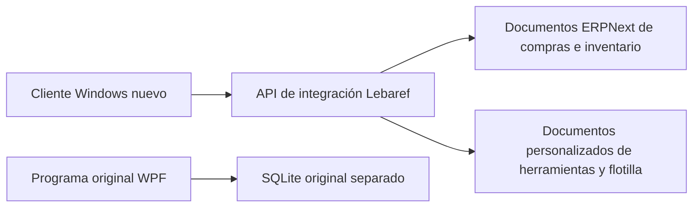

# Auditoría de equivalencia: Lebaref original e integración ERPNext

**Dictamen: equivalencia completa NO acreditada. La versión actual no debe sustituir todavía al programa original.**

19 de noviembre de 2026. Rama `integracion/erpnext`; código auditado `6822b90`.
Se verificó el recorrido básico implementado y se identificaron faltantes que afectan
la operación habitual, no solamente el aspecto visual.

## Resultado ejecutivo

La integración es un cliente nuevo de Windows, conectado a ERPNext mediante API.
No es el escritorio de ERPNext ni una actualización de la interfaz WPF original.
Las compras y existencias usan documentos estándar de ERPNext; herramientas,
kits y flotilla usan documentos personalizados de Lebaref. La base SQLite original
permanece separada, sin sincronización ni migración realizadas.

Se agruparon **55 capacidades y condiciones de puesta en marcha**. El inventario
estático contiene 19 archivos originales y 260 nombres únicos de eventos Click
conectados en MainWindow.xaml. No se usa el número de botones como medida de avance.

| Estado | Cantidad | Interpretación |
|---|---:|---|
| Verificado acotado | 8 | Pasó el caso descrito; no todas sus variantes |
| Parcial | 16 | Hay una parte implementada, pero faltan datos, acciones o validación |
| No integrado | 24 | No existe un recorrido equivalente en el cliente entregado |
| Cambio de comportamiento | 4 | Hay una decisión de proceso o interfaz por homologar |
| Sin verificar | 3 | Falta evidencia suficiente |

Estos conteos **no son un porcentaje de finalización**: los puntos tienen tamaños
muy distintos e incluyen condiciones de despliegue y capacidades de ERPNext cuyo
alcance debe decidirse. Que ERPNext tenga un módulo no significa que el cliente
Windows lo exponga, que las cuentas puedan operarlo o que esté configurado.

La [matriz detallada](auditoria/MATRIZ-EQUIVALENCIA.md) registra por capacidad el
comportamiento original, el actual, su evidencia y el criterio para cerrar la brecha.

## Hallazgos que impiden declarar equivalencia

### H01 · Solicitudes incompletas respecto al original — P1

El original admite conceptos sin SKU, unidad libre, departamento, encargado, origen,
notas, edición y anexos. La captura nueva solicita empresa, fecha, título y artículos
catalogados, y confirma al guardar. No conserva el mismo proceso previo a la compra.
También falta el recorrido de aprobar una solicitud para surtir desde stock.

**Impacto:** obliga a crear catálogos anticipadamente, pierde contexto del solicitante
y no permite continuar algunas solicitudes de la misma forma. Matriz SOL-02 a SOL-05,
CAT-04. Cierre: capturar un concepto libre, autorizar surtido parcial y comprar el
restante, conservando persona, departamento, obra, partida y saldos.

### H02 · Ofertas parciales de proveedores rechazadas — P1

La prueba específica envió una oferta con 1 de los 2 renglones de una petición.
La API respondió: «Cotiza todos los renglones de la petición una sola vez».
El original captura y adjudica por artículo/proveedor; no todos los proveedores
necesitan vender todos los materiales.

**Impacto:** puede impedir comparar proveedores especializados. COM-02.
Cierre: aceptar una oferta parcial, mostrar qué no fue cotizado y emitir órdenes
por los renglones adjudicados sin inventar precios para los demás.

### H03 · Totales comerciales no homologados — P1

El código original agrega flete y calcula 16% fijo al generar ciertas órdenes.
La nueva interfaz captura precio sin impuestos y no permite capturar esos conceptos;
depende de configuración o intervención administrativa de ERPNext.
La orden ficticia PUR-ORD-2026-00007 tiene neto 400, impuestos 0 y total 400 MXN.
Esto acredita el escenario de prueba, no que todas las órdenes del servidor carezcan
de impuestos. Con un caso de aceptación de neto 400 e impuesto explícito de 64,
el total esperado sería 464; ese caso no está homologado.

**Impacto:** las mismas capturas aparentes pueden producir totales distintos.
COM-04 y COM-07. Cierre: configurar y probar flete, impuestos aplicables, descuentos,
condiciones, programación y seguimiento de pago. El 16% fijo del original es una
regla de código observada, no una regla que deba copiarse a toda operación.

### H04 · Unidades correctas en servidor, ambiguas en captura — P1

Se creó temporalmente un artículo con unidad de compra distinta de inventario y
factor 10. Una solicitud de cantidad 2 quedó en la unidad de compra, con factor 10
y cantidad de inventario 20. La conversión de ERPNext funcionó.
Sin embargo, la nueva captura de solicitud muestra «Cantidad» sin la unidad y
no permite configurar/seleccionar el factor o unidad de compra desde Windows.

**Impacto:** quien captura puede interpretar 2 piezas donde el servidor entiende
2 cajas. CAT-02. Cierre: mostrar unidad junto a cantidad y probar el recorrido completo
caja → recepción parcial → salida en piezas → sobrante, incluidos decimales.

### H05 · Faltan variantes de recepción y regularización — P1

No están integradas entrada sin OC, regularización posterior, sustitución aprobada
al recibir, compra con nota/ticket y la captura específica de recepción directa a
obra o servicio no inventariable. Recibir en un almacén de obra configurado en la
orden no reproduce por sí solo el procedimiento original con remisión y persona.

**Impacto:** compras urgentes y excepciones comunes no tienen un recorrido completo.
ALM-02 a ALM-04, XML-03. Cierre: realizar cada variante conservando cantidades,
referencias y costos, sin duplicar entradas al regularizar.

### H06 · Transferencia a obra no equivale a consumo — P1

El original descuenta stock en la salida y calcula costo neto consumido con sus
retornos. La integración transfiere material a otro almacén: la cantidad sigue
siendo inventario. Tampoco existe todavía la captura nativa de ajustes/merma ni
el retorno de sobrantes históricos sin una entrega de la nueva base.

**Impacto:** existencias globales y costos de obra no se interpretan igual.
ALM-05, ALM-07 y ALM-08. Cierre: distinguir entrega, resguardo en obra, consumo,
sobrante y merma; validar cantidades y costos en cada paso.

### H07 · CFDI archivado no equivale al proceso XML original — P1

El original procesa conceptos, asocia o crea productos/proveedor y puede sincronizar
órdenes/entradas. Lo nuevo valida encabezado, RFC y UUID, y guarda un archivo privado
ligado a una recepción. No concilia conceptos/importes ni crea Purchase Invoice o
Payment Entry. Se comprobó que la inserción directa sin XML, incluso pasando una
bandera de validación en los datos, fue rechazada; esa protección sí funcionó.

**Impacto:** falta una parte sustancial de regularización y conciliación de compras.
XML-01 a XML-04. Cierre: homologar vínculo concepto/producto, cantidades, importes,
UUID y recepción, y definir aparte el alcance contable. No se acredita validación SAT.

### H08 · Permisos administrativos más amplios que los botones — P1

La consulta de permisos efectivos confirmó:

| Perfil | Autorizar OC | Cancelar OC | Cancelar recepción | Cancelar movimiento de almacén |
|---|---|---|---|---|
| Compras | No | No | No | No |
| Responsable | Sí | Sí | No | No |
| Almacén | No | No | Sí | Sí |

La interfaz de Windows no ofrece todas esas cancelaciones, pero los permisos de
servidor existen. No se ejecutó una cancelación en esta auditoría; es una capacidad
confirmada por metadatos de permisos, sujeta a las validaciones del documento.
No implica que Almacén pueda autorizar compras ni que exista una escalada de permisos.

**Impacto:** ocultar botones no define la política real. SEG-01.
Cierre: aprobar y probar una matriz de acciones que incluya API y acceso administrativo,
con motivo/autoridad de corrección. No conceder derechos adicionales por defecto.

### H09 · Faltan formatos operativos y correcciones — P1

El original imprime solicitudes, comparativas, OC, entradas, salidas, préstamos,
checklists y carta responsiva de EPP. El nuevo cliente ofrece CSV y etiquetas;
no esos formatos. Tampoco cubre corrección/anulación de gastos y revisiones de
flotilla; la anulación implementada solo corresponde a mantenimiento de herramientas.

**Impacto:** falta soporte documental y una vía para corregir errores de captura.
DOC-01 y FLO-03. Cierre: formatos con folios/personas y corrección con historial,
sin replicar borrados destructivos del sistema anterior.

### H10 · Seguimiento, análisis y consulta histórica incompletos — P1/P2

Faltan agenda, checkpoints, notificaciones, banco de precios, análisis PPV/Kraljic,
consumo por cuadrilla y métricas de flotilla como costo/km y rendimiento.
Los listados nuevos muestran 100 recientes y los selectores hasta 1,000 referencias;
solo herramientas, vehículos y kits tienen búsqueda exacta fuera del listado.

**Impacto:** una OC antigua puede quedar inaccesible desde esa pantalla, y el auxiliar
pierde tareas y contexto que sí tenía en el original. GES, ANA, FLO-02 y UX-01.
Cierre: filtros/paginación por folio/fecha/persona y seguimiento de pendientes.

### H11 · Custodia manual separada de inventario — P1

Las fichas de herramientas se crean manualmente y se vinculan a Item, pero no a una
unidad recibida concreta o a su costo de compra. La custodia funciona en su propio
registro; no se acreditó conciliación automática con compras/existencias.
En el original hay un método de alta desde recepción, pero no se hallaron llamadas
al método: no se considera demostrado que esa automatización estuviera operativa.

**Impacto:** se necesita una regla de conciliación para evitar fichas duplicadas o
unidades sin ficha. HER-01. Cierre: enlazar el alta a las unidades adquiridas y
conciliar inventario frente a custodia; comprobar primero el flujo original efectivo.

### H12 · Migración y puesta en marcha pendientes — P1

No se migraron históricos ni saldos. La recuperación documentada corresponde al
respaldo anterior a herramientas/kits; no se ha acreditado restauración de toda la
versión actual. Faltan servidor privado compartido, cuentas nominales, HTTPS,
restricción de red y prueba entre estaciones físicas. Tampoco se verificaron cortes
reales ni impresora/lector físicos.

**Impacto:** el paquete actual es de pruebas, no un reemplazo operativo listo para
distribución. OPS-01 a OPS-04. Cierre: migración de ensayo conciliada, restauración
completa, pruebas de red/reconexión y aceptación de los auxiliares.

## Evidencia ejecutada durante esta auditoría

| Comprobación | Resultado | Alcance |
|---|---|---|
| Suite integral | Correcto | Flujo simple de compra, recepción, entrega, retorno, XML y roles |
| Suite equipos | Correcto | Custodia, incidencias, validaciones básicas de flotilla |
| Suite kits | Correcto | Composición, préstamo selectivo, garantía y costos/anulación |
| Oferta parcial 1 de 2 | Rechazada | Brecha funcional reproducida; no un fallo de la suite existente |
| Conversión de compra | 2 × 10 = 20 | Servidor correcto; unidad no expuesta en captura |
| Inserción CFDI sin archivo | Rechazada | También con bandera de validación enviada dentro del documento |
| Permisos efectivos | Consultados | Diferencias entre capacidad del servidor y acciones visibles |
| Código local/instalado | 8/8 coincide | SHA256 sobre UTF-8 con saltos de línea normalizados |

Todas las escrituras de los sondeos se ejecutaron en el sitio ficticio
`lebaref-pruebas.local` y sus transacciones fueron revertidas. No se modificó el
programa original ni se enviaron correos. El servidor de pruebas estaba detenido
al iniciar los sondeos y se puso en marcha con su tarea local existente.

**Versiones reales consultadas:** ERPNext 16.55.0 y Frappe 16.56.0. La documentación
previa agrupaba ambas como 16.55.0; esta auditoría corrige esa identificación.

Evidencias: [resultados](auditoria/resultados.json), [unidades](auditoria/unidades.json),
[huellas del servidor](auditoria/HASHES-SERVIDOR.json),
[baseline del original](auditoria/BASELINE.json),
[inventario de código/eventos](auditoria/INVENTARIO-ORIGINAL.md).

Las suites prueban los recorridos que se programaron; no prueban automáticamente
funciones del original que nunca se incluyeron. En esta auditoría no se ejecutó
el original con una copia aislada de datos ni se hizo revisión manual de todas
las pantallas. No se afirma equivalencia numérica de históricos reales.

## Orden de cierre propuesto y aceptación

| Orden | Trabajo | Condición para darlo por cerrado |
|---|---|---|
| 1 | Solicitud, unidades, cotización parcial y condiciones comerciales | Mismo caso produce cantidades, proveedores, importes y referencias acordados |
| 2 | Recepciones excepcionales, consumo/merma, XML y nota/ticket | Resolver operaciones normales y excepciones sin doble inventario/compra |
| 3 | Permisos, correcciones, formatos, búsqueda y pendientes | Cada perfil puede completar su trabajo y corregir errores con trazabilidad |
| 4 | Catálogos completos, informes y ergonomía | Se conserva cada función requerida del original o se documenta su retiro |
| 5 | Migración de ensayo, restauración y oficina | Saldos/vínculos conciliados, recuperación comprobada y dos estaciones funcionando |
| 6 | Aceptación operativa | Auxiliares completan casos representativos sin intervención técnica |

La auditoría técnica queda entregada con sus hallazgos abiertos. No se cambiaron
reglas del producto para hacer pasar la revisión, ni se declaró resuelta ninguna
brecha por el hecho de que ERPNext disponga de un módulo parecido.
